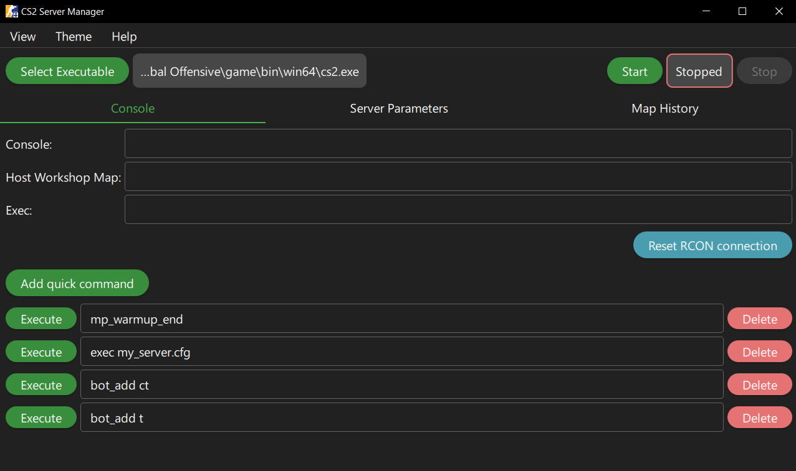
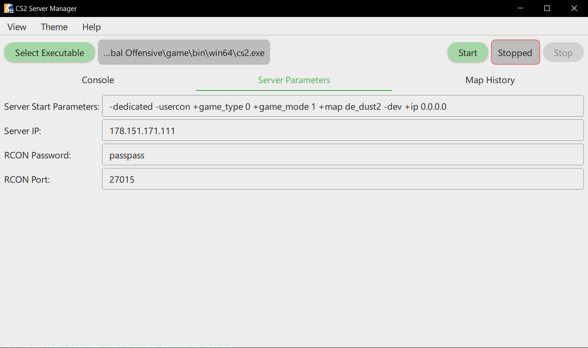
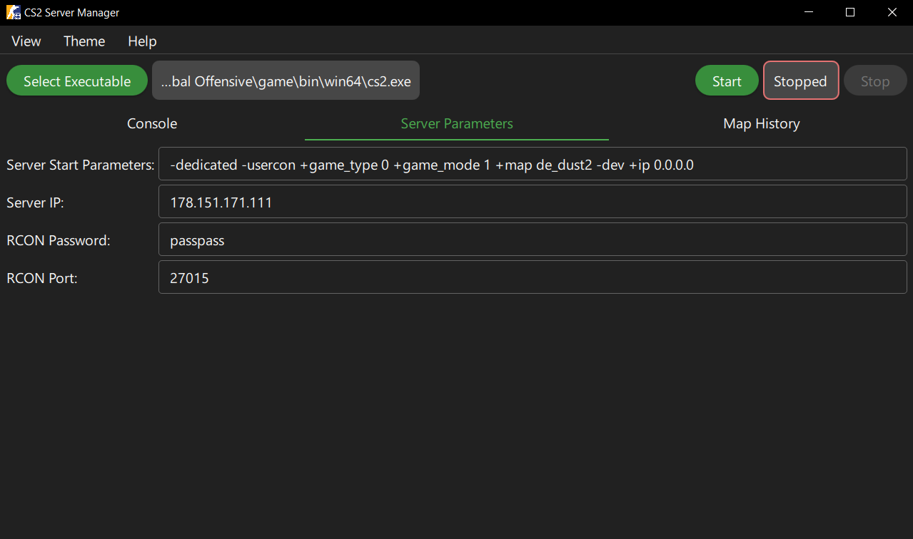
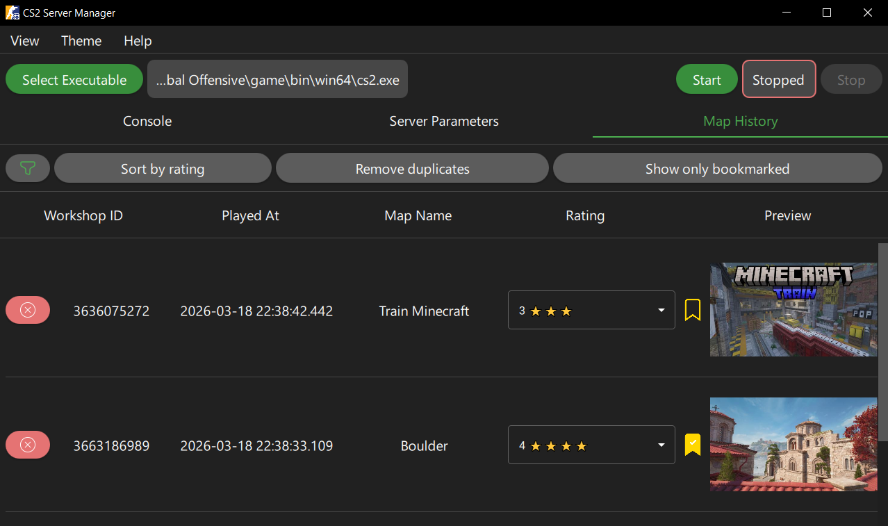
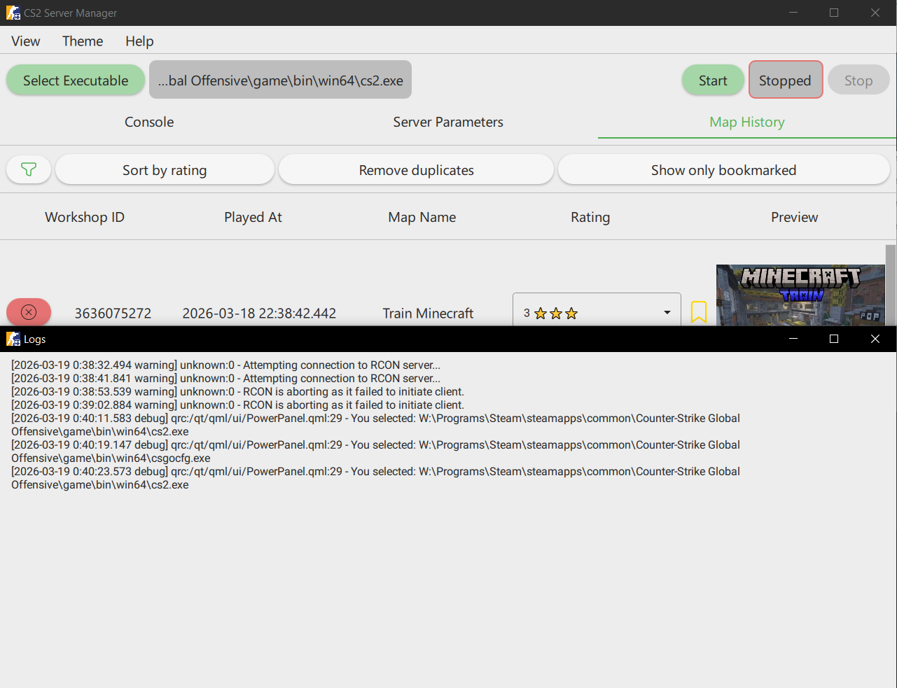

# CS2 Server Manager

   

This is a very simple app I've created for managing my local server to play with friends because typing commands into the server cmd was not convenient. The app is mostly intended to be used with local server on the same machine, but you also can connect to any remote server via RCON (Stopping and starting will not work).

Written in C++ and QML as an exercise.

## UI

    

## Features

✅ Start and stop local server

✅ Config file in the working directory

✅ No installer, everything works inside app directory

✅ RCON Console and some additional helpful inputs

✅ History of the entered commands

✅ Scaling on different resolutions, users can also change the scale from app settings

✅ Light and dark themes

✅ History of the downloaded maps

## Build

### Windows prerequisites

The project uses Conan 2 package manager, so make sure Conan is installed and is invokable, e.g.:
```
$ pip install conan

$ conan --version
Conan version 2.24.0
```

If build fails with conan profile related issue, try:
```
conan profile detect --force
```

Versions of dependencies used, probably will work on newer versions as well:

- QtCreator (Windows) or VSCode
- Qt 6.10.2
- [rconpp](https://github.com/Jaskowicz1/rconpp) at [d77993b](https://github.com/Jaskowicz1/rconpp/commit/d77993b1e8993701dbf6b2974b41045a915c7b42)
- Conan 2.26.2
- CMake 4.2.0

### Build Process Windows

You can use either VSCode or QTCreator to build the application, but both of them might require some additional setup. In both cases I think you need to also set up env variables e.g.:

```
QTDIR=W:\Programs\Qt\6.10.2\msvc2022_64
And add path to bin folder to PATH (e.g. W:\Programs\Qt\6.10.2\msvc2022_64\bin)
```

#### 1. VSCode

Open Native x64 development tools that are provided by the MSVC compiler, start VSCode, you should be able to build now.

#### 2. QT Creator

Open the project in Qt Creator, make sure that in the `Projects` pane one of the detected or configured Kits is selected (not the cmake presets one) and hit build. The kit from cmake presets does not work currently.

### Linux Dev Container on Wayland

On a Linux Wayland desktop with local Docker and the VS Code Dev Containers extension, open the repository from your desktop session and run **Dev Containers: Reopen in Container**. The Ubuntu 24.04 image includes GCC, Ninja, Conan, Qt 6.10.2, and Rust stable via rustup with Cargo, rustfmt, and Clippy. It installs CMake from Kitware’s stable APT repository. [Kitware APT repository](https://apt.kitware.com/)

Select the `debug` or `release` configure preset in CMake Tools. From the container terminal, the `debug` preset builds the app and tests.

```bash
cmake --preset debug
cmake --build --preset debug
cd build/devcontainer/debug/src
./cs2guiserver
```

From the repository root in the container, build an optimized release with the `release` preset. The executable is at `build/devcontainer/release/src/cs2guiserver`.

```bash
cmake --preset release
cmake --build --preset release
```

The app opens on the host desktop through the Wayland socket. The container defaults to Qt Quick software rendering, so the app can run without GPU passthrough. File dialogs use the host desktop portal through the session D-Bus socket and browse the host filesystem. A selected path must also be visible at that path in the container for the app to use it. To run CS2 on the host, start the server there and connect from the containerized app over RCON.

Run `wayland-info` in the container terminal to check the compositor connection. If the host Wayland session restarts, run **Dev Containers: Rebuild Container** from the new desktop session to pick up the new socket.

## Deploy

### Windows

In order to deploy the built binary you need to have `windeployqt.exe` reachable from the `powershell` (easiest way is to set `QTDIR` environment variable on your system).

There are a few scripts, one to move the binary and all required dependencies:
```powershell
# From project root directory.
.\scripts\deploy_win.ps1 .\build\Release-Desktop_Qt_6_7_0_MSVC2019_64bit_MSVC2022 .\deploy\cs2guiserver
```

And the second is to package the new directory into an archive:
```powershell
.\scripts\package_win.ps1 .\deploy\cs2guiserver
```

For convenience there is also a combined script:
```powershell
.\scripts\deploy_and_package_win.ps1 .\build\Release-Desktop_Qt_6_7_0_MSVC2019_64bit_MSVC2022 .\deploy\cs2guiserver
```

### Linux

The Docker release builder uses Ubuntu 24.04 and links Qt statically for distribution.
```
docker build --build-arg USER_ID=$(id -u) --build-arg GROUP_ID=$(id -g) -t app-builder .
docker run --rm -v $(pwd):/build -v $(pwd)/install:/install app-builder
```

After that you can just copy the binary from `install/bin` folder and distribute it.

### Supported Platforms

Windows: Tested on Windows 10 22H2 (19045.4412), but in theory should work on any version of Win10 and above.

The Linux executable was tested on EndeavourOS (6.18.7-arch1-1).
